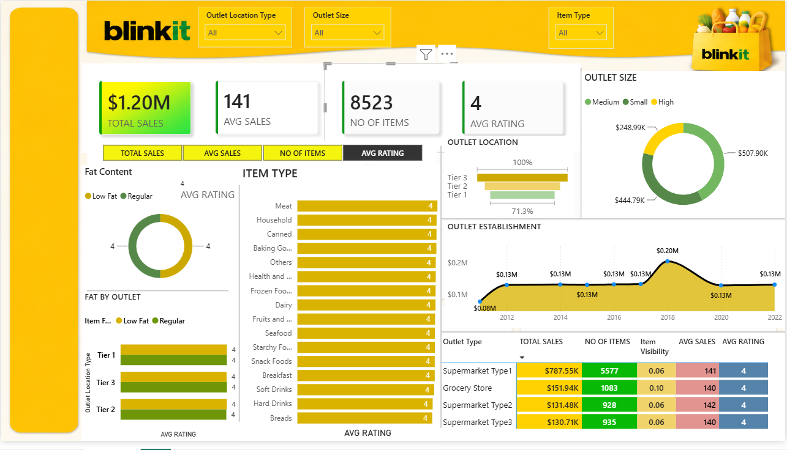

# 🛒 Blinkit Sales Analysis Dashboard | Power BI

## 📌 Project Overview

The Blinkit Sales Analysis Dashboard is an interactive Business Intelligence project developed using Microsoft Power BI. It focuses on analyzing grocery sales data to understand sales performance, product categories, outlet characteristics, and customer-related trends.

The dashboard transforms raw sales data into meaningful insights through interactive visualizations, KPI cards, charts, and filters.

## 🎯 Project Objectives

- Analyze overall sales performance.
- Identify top-performing product categories.
- Compare sales based on item fat content.
- Understand outlet-level sales performance.
- Analyze the impact of outlet size and location.
- Explore sales trends based on outlet establishment year.

## 🛠️ Tools & Technologies

- Microsoft Power BI Desktop
- Power Query
- DAX (Data Analysis Expressions), if used
- Data Cleaning and Transformation
- Data Visualization

## 📊 Key Performance Indicators

The dashboard presents important business metrics:

- Total Sales
- Average Sales
- Number of Items
- Average Rating

## 📈 Dashboard Features

### 1. Sales Overview
Provides a summary of overall sales performance using KPI cards.

### 2. Item Type Analysis
Explores sales distribution across different grocery product categories.

### 3. Fat Content Analysis
Compares item sales based on low-fat and regular-fat categories.

### 4. Outlet Location Analysis
Examines sales performance across different outlet location types.

### 5. Outlet Establishment Analysis
Explores sales trends based on outlet establishment year.

### 6. Outlet Size Analysis
Compares the contribution of different outlet sizes.

### 7. Outlet Type Analysis
Provides a comparative view of sales across outlet types.

## 💡 Business Questions Explored

- Which product categories contribute most to sales?
- How do different outlet locations perform?
- What is the contribution of different outlet sizes?
- How does sales performance vary across outlet types?
- What patterns can be observed in outlet establishment trends?
  
## 📸 Dashboard Preview



## 📂 Project Structure

```text
Blinkit-Sales-Analysis-PowerBI/
│
├── Blinkit_Sales_Analysis.pbix
├── dashboard-overview.png
└── README.md
```

## 🚀 How to Run the Project

1. Clone or download this repository.
2. Download the Power BI `.pbix` file.
3. Install Microsoft Power BI Desktop.
4. Open the downloaded file in Power BI Desktop.
5. Explore the dashboard and its interactive visualizations.

## 📌 Project Outcome

This project demonstrates the use of Power BI for business intelligence, data exploration, KPI analysis, and interactive dashboard development.

It provides practical exposure to transforming sales data into visual insights that support data-driven decision-making.

---

**Project Domain:** Data Analytics | Business Intelligence

**Tool:** Microsoft Power BI

**Project Type:** Interactive Sales Analysis Dashboard

**Status:** Completed
